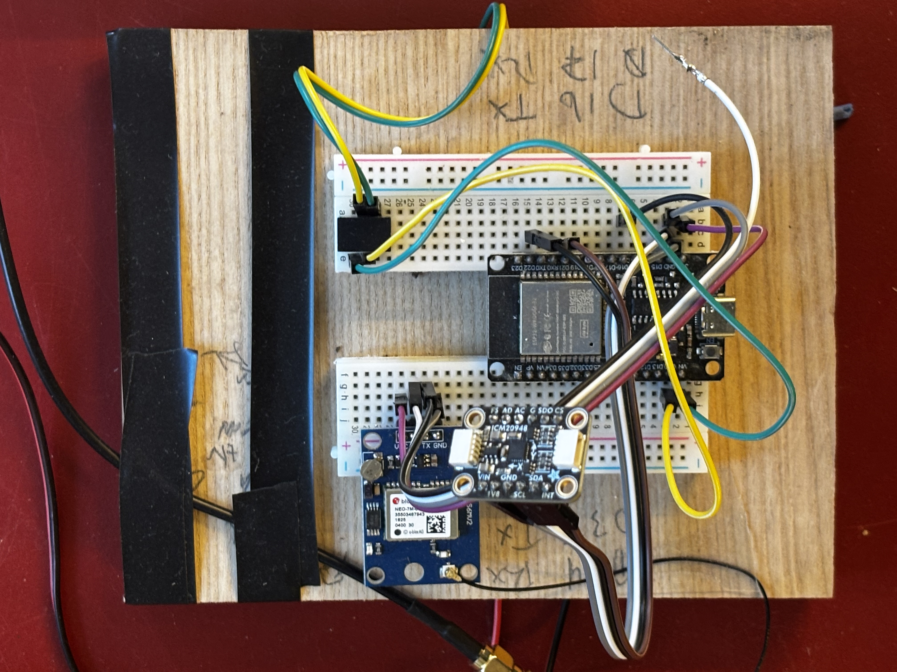
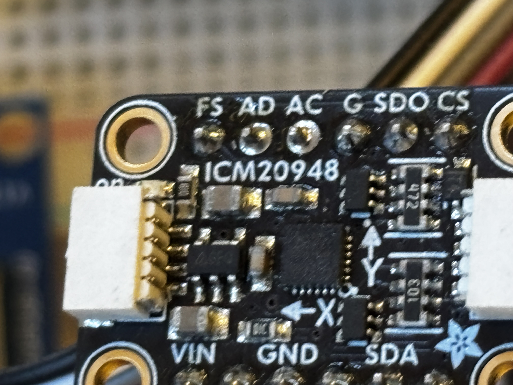

# navigation_input

ESP32 sensor node that measures the boat's magnetic heading and GPS data and publishes them to the SignalK hub (salkavpn).

## Hardware

| Component | Interface | Purpose |
|---|---|---|
| ESP32-WROOM-32 dev board (PlatformIO env `upesy_wroom`) | — | Controller, WiFi |
| Adafruit ICM-20948 9-DOF breakout | I2C: SDA GPIO21, SCL GPIO22 | Magnetometer gives the magnetic heading. The accelerometer and gyro are read but not used. |
| u-blox NEO-7M GPS module + external antenna | UART2: ESP32 RX GPIO16, TX GPIO17, 9600 baud | Position, SOG, COG, time, number of satellites |
| Traco Power TSR 1-2450E DC/DC converter | — | 12V boat supply → 5V for the ESP32 |

### Power

```
12VDC boat supply ─► TSR 1-2450E ─► 5V ─► ESP32 5V/VIN pin
                                          ESP32 onboard regulator ─► 3.3V ─► ICM-20948 + NEO-7M
```

Both sensors run from the ESP32's 3.3V pin. **The ICM-20948 is 3.3V only.** Do not connect it to 5V.

### Wiring

| From | To |
|---|---|
| 12VDC supply | TSR 1-2450E input |
| TSR 1-2450E 5V out / GND | ESP32 5V (VIN) / GND |
| ICM-20948 VIN / GND | ESP32 3.3V / GND |
| ICM-20948 SDA | GPIO21 |
| ICM-20948 SCL | GPIO22 |
| NEO-7M VCC / GND | ESP32 3.3V / GND |
| NEO-7M TX | GPIO16 (ESP32 RX) |
| NEO-7M RX | GPIO17 (ESP32 TX) |

### Prototype (current state)

The unit is still a breadboard prototype mounted on a wooden board.


The ICM-20948 axis markings show X pointing left and Y pointing up on the board. The heading calculation assumes this orientation, so mount the sensor flat and keep it aligned with the boat's fore-aft axis.



## What it does

Every 500 ms it publishes a SignalK delta over WebSocket to `ws://192.168.8.115:3000/signalk/v1/stream`:

| SignalK path | Source |
|---|---|
| `navigation.headingMagnetic` | ICM-20948 magnetometer (rad) |
| `navigation.position` | GPS |
| `navigation.speedOverGround` | GPS (m/s) |
| `navigation.courseOverGroundTrue` | GPS (rad) |
| `navigation.datetime` | GPS |
| `navigation.gnss.satellites` | GPS |

GPS values are only sent once they are valid. Until the magnetometer has been calibrated, the unit sends no heading.

## Magnetometer calibration

Calibration is hard-iron only: the unit records the min/max of each axis and subtracts the centre offsets. The result is stored in NVS, so it survives a reboot.

1. `curl http://navigation-input.local/calibrate/start`
2. Motor the boat in 2 slow full circles.
3. `curl http://navigation-input.local/calibrate/stop`

Stop is refused until at least 200 samples have been collected. Calibration stops on its own after 10 minutes. No data is published while it runs.

## Network

- WiFi `SalkaValka`, mDNS hostname `navigation-input.local`
- `GET /status` returns a JSON status page (see the ESP32 node conventions in the top-level `CLAUDE.md`)
- OTA updates via ArduinoOTA
- WebSocket heartbeat (ping every 15 s; the connection is dropped after 2 missed pongs) with automatic reconnect

## Build and flash

```bash
pio run -t upload                                        # first flash (USB)
pio run -t upload --upload-port navigation-input.local   # OTA, on the boat network
../ota_upload.sh navigation_input                        # OTA from home, via salkavpn
pio device monitor                                       # serial console, 115200 baud
```

## Limitations / TODO

- **No tilt compensation.** Heading uses only the magnetometer's X/Y axes, so it will drift when the boat heels or pitches.
- **No magnetic declination correction.** Only a magnetic heading is published, not a true one.
- Prototype on a breadboard; needs a permanent build and enclosure.
